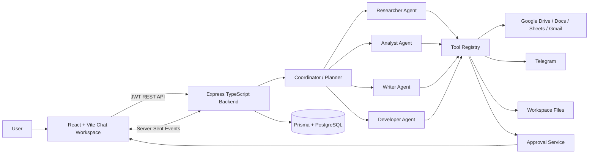

# Anavya

> **Your AI workspace. Your agents. Your work, done.**

Anavya is a chat-first autonomous AI workspace. A user describes an objective in natural language, and Anavya creates an execution plan, selects specialist agents, invokes permitted tools, uses connected applications, and returns the result in the requested format.

Unlike a general-purpose chatbot, Anavya models work as persisted conversations, tasks, agent steps, tool executions, approvals, and artifacts. It can therefore coordinate multi-step work instead of only generating a reply.

## Problem

People lose time switching between communication, document, storage, and data applications. They repeatedly research information, analyze files, prepare documents, and draft messages across disconnected workflows. Traditional chatbots usually provide an answer but do not safely complete the surrounding work, preserve execution history, or ask for approval before external side effects.

## Solution

Anavya provides one workspace for delegating those objectives. The Coordinator plans the work, specialist agents execute the relevant steps, and the tool registry limits which integrations each agent can use. Google Workspace and Telegram actions are connected to the authenticated user account, while sensitive actions can pause for human approval.

The current implementation includes Google Drive, Google Docs, Google Sheets, Gmail, and Telegram adapters. Availability still depends on credentials, permissions, and the connected account. See [Integration status](#integration-status).

## Feature status

| Capability | Status | Notes |
|---|---|---|
| Conversational workspace and persisted chat history | **Implemented** | Conversations and messages are stored through Prisma/PostgreSQL or the local development fallback. |
| Multi-step task orchestration | **Implemented** | Tasks contain ordered specialist steps, executions, outputs, artifacts, and status changes. |
| Coordinator, Researcher, Analyst, Writer, and Developer agents | **Implemented** | Default agents are created for each user and can be configured through the Agent Studio. |
| Custom agent creation, duplication, permissions, and test sandbox | **Implemented** | Agent settings include tools, action permissions, execution behavior, output preferences, and memory settings. |
| Google Drive, Docs, Sheets, Gmail, and Telegram adapters | **Implemented, credential-dependent** | OAuth or Telegram bot setup is required for live operations. |
| Human approval for external side effects | **Implemented** | Approval cards support approve, reject, and editable drafts for supported actions. |
| Workspace uploads and generated artifacts | **Implemented** | Uploads are limited by `MAX_UPLOAD_SIZE_MB`; generated files are associated with tasks. |
| Memory CRUD and task-context retrieval | **Implemented** | Memory endpoints and relevant-memory retrieval are available. |
| Reusable automations | **Implemented** | Automations can be created, listed, run, and inspected. A predefined sales-report automation is seeded for users. |
| Persistent scheduled-task execution | **Planned** | A `ScheduledTask` database model exists, but scheduler routes and a durable worker are not currently wired. |
| Production-grade observability and job queue | **Planned** | Execution events exist through SSE, but there is no separate queue/worker or full observability stack. |

## Architecture



### Request lifecycle

1. The frontend sends a natural-language objective to the chat API.
2. The backend creates and persists the user message and task.
3. The Coordinator creates a validated execution plan.
4. Each plan step resolves the user’s active agent configuration for that role.
5. The specialist checks tool permissions, runs deterministic tools or Gemini reasoning, and records the result.
6. External side effects that require approval pause the task and create an approval card.
7. Results, tool cards, artifacts, and final summaries are persisted and streamed to the frontend.

## Technology stack

| Layer | Technologies |
|---|---|
| Frontend | React 19, TypeScript, Vite, Tailwind CSS, Zustand, React Router, Axios |
| Backend | Node.js, Express, TypeScript, Zod, Multer |
| AI | Google Gemini through `@google/genai` |
| Persistence | Prisma Client with PostgreSQL; local JSON fallback for development/tests |
| Authentication | JWT and bcryptjs |
| Integrations | Google OAuth and Google APIs; Telegram Bot API |
| Security and operations | Helmet, CORS, express-rate-limit, Swagger/OpenAPI, Server-Sent Events |
| Testing | Vitest and Supertest |

## Project structure

```text
.
├── backend/
│   ├── prisma/schema.prisma       # PostgreSQL data model
│   ├── src/
│   │   ├── app.ts                 # Express middleware and top-level routes
│   │   ├── server.ts              # Backend entry point
│   │   ├── routes/                # Versioned REST routes
│   │   ├── controllers/           # HTTP request handlers
│   │   ├── services/
│   │   │   ├── ai/                # Gemini planning and agent prompts
│   │   │   ├── agents/            # Agent definitions, permissions, execution
│   │   │   ├── orchestration/     # Task planning and ordered execution
│   │   │   ├── tools/              # Registered tool schemas and execution
│   │   │   ├── integrations/       # Google and Telegram services
│   │   │   ├── approvals/          # Human approval workflow
│   │   │   ├── memory/             # User memory operations
│   │   │   └── automations/        # Reusable workflow execution
│   │   ├── middleware/             # Authentication, validation, errors
│   │   ├── schemas/                # Zod request validation
│   │   └── config/                 # Environment and database setup
│   └── tests/api.test.ts           # Integration verification suite
├── frontend/
│   └── src/
│       ├── pages/                  # Chat, agents, plugins, history, settings
│       ├── components/             # Shared UI and application icons
│       ├── context/                # Zustand workspace state
│       └── api/                    # Axios API client
├── render.yaml                     # Render backend deployment configuration
└── README.md
```

## Local setup

### Prerequisites

- Node.js 20 or newer
- npm
- PostgreSQL for durable local development
- Google Gemini API key for live AI planning
- Google OAuth credentials for Google integrations
- A Telegram bot token only if Telegram is required

### Install

```bash
git clone <repository-url>
cd BuildToShipHackathon

cd backend
npm install
npx prisma generate

cd ../frontend
npm install
```

### Configure the backend

Copy `backend/.env.example` to `backend/.env` and set the values described below. Do not put backend secrets in frontend environment variables.

For PostgreSQL development, set `DATABASE_URL` to a database you control and then run either:

```bash
cd backend
npm run prisma:migrate
```

or, for a schema push without migration files:

```bash
npx prisma db push
```

The application can use its local JSON fallback when PostgreSQL is not active, but that fallback is not appropriate for production durability.

### Start the services

In terminal 1:

```bash
cd backend
npm run dev
```

In terminal 2:

```bash
cd frontend
npm run dev
```

The frontend runs on `http://localhost:5173` and the backend defaults to `http://localhost:5000`.

### Available scripts

Backend:

```bash
npm run dev
npm run build
npm start
npm test
npm run test:watch
npm run prisma:generate
npm run prisma:migrate
```

Frontend:

```bash
npm run dev
npm run build
npm run preview
```

## Environment variables

### Backend

| Variable | Required for | Description |
|---|---|---|
| `PORT` | Backend | Defaults to `5000`. |
| `NODE_ENV` | Backend | `development`, `test`, or `production`. |
| `FRONTEND_URL` | CORS/OAuth | Frontend origin; comma-separated origins are supported. |
| `DATABASE_URL` | Durable persistence | PostgreSQL connection string. |
| `JWT_SECRET` | Authentication | Long random signing secret. |
| `JWT_EXPIRES_IN` | Authentication | JWT lifetime, default `7d`. |
| `GEMINI_API_KEY` | Live AI | Google AI Studio/Gemini API key. |
| `GEMINI_MODEL` | Live AI | Gemini model name. |
| `GOOGLE_CLIENT_ID` | Google OAuth | OAuth client ID. |
| `GOOGLE_CLIENT_SECRET` | Google OAuth | OAuth client secret. |
| `GOOGLE_REDIRECT_URI` | Google OAuth | Must match the OAuth console callback URL. |
| `GOOGLE_TOKEN_ENCRYPTION_KEY` | Google token storage | Secret used to encrypt OAuth tokens at rest. |
| `TELEGRAM_BOT_TOKEN` | Telegram | BotFather token. |
| `TELEGRAM_WEBHOOK_SECRET` | Telegram webhook | Secret used to validate webhook requests. |
| `WORKSPACE_ROOT` | Workspace files | Local artifact directory, default `./workspace`. |
| `MAX_UPLOAD_SIZE_MB` | File uploads | Upload limit, default `10`. |
| `AI_MOCK_MODE` | Local tests/demo | Set `true` for deterministic development behavior. |

### Frontend

| Variable | Description |
|---|---|
| `VITE_API_BASE_URL` | Backend API base URL, normally `http://localhost:5000/api/v1`. |

## API overview

The backend exposes Swagger UI at `/api-docs` and the OpenAPI JSON document at `/api-docs.json`. The API prefix is `/api/v1`.

All endpoints below require a JWT unless noted otherwise.

### System and authentication

| Method | Endpoint | Purpose |
|---|---|---|
| `GET` | `/health` | Health and AI configuration status; public |
| `GET` | `/tools` | List registered tools |
| `GET` | `/events?token=<jwt>` | Authenticated SSE execution stream |
| `POST` | `/auth/register` | Register with email and password |
| `POST` | `/auth/login` | Obtain a JWT |
| `GET` | `/auth/google` | Start Google OAuth login |
| `GET` | `/auth/me` | Read the authenticated user |

### Chat, tasks, agents, and approvals

| Method | Endpoint | Purpose |
|---|---|---|
| `POST` | `/chat/conversations` | Create a conversation |
| `GET` | `/chat/conversations` | List/search conversations |
| `GET` | `/chat/conversations/:id` | Retrieve messages and tasks |
| `PATCH` | `/chat/conversations/:id` | Rename or update a conversation |
| `DELETE` | `/chat/conversations/:id` | Delete a conversation |
| `POST` | `/chat/conversations/:id/messages` | Send an objective and run it |
| `GET/POST/PATCH/DELETE` | `/agents...` | Manage and test agent configurations |
| `POST` | `/tasks` | Create a task |
| `GET` | `/tasks` | List tasks |
| `GET` | `/tasks/:id` | Retrieve task details |
| `POST` | `/tasks/:id/cancel` | Cancel a task |
| `GET` | `/tasks/:id/executions` | List executions |
| `GET` | `/approvals` | List approvals |
| `GET` | `/approvals/pending` | List pending approvals |
| `POST` | `/approvals/:id/approve` | Approve, optionally editing a draft |
| `POST` | `/approvals/:id/reject` | Reject an action |

Example:

```bash
curl -X POST http://localhost:5000/api/v1/chat/conversations/<conversation-id>/messages ^
  -H "Authorization: Bearer <jwt>" ^
  -H "Content-Type: application/json" ^
  -d "{\"content\":\"Analyze my sales CSV and summarize the top products\"}"
```

### Workspace, memory, and automations

| Method | Endpoint family | Purpose |
|---|---|---|
| `GET/POST/PATCH/DELETE` | `/memory...` | Manage user memories |
| `GET/POST/DELETE` | `/workspace/files...` | List, upload, download, and delete files |
| `GET/POST` | `/automations...` | Create/list/retrieve reusable automations |
| `POST` | `/automations/:id/run` | Run an automation |
| `GET` | `/automations/:id/executions` | Read automation executions |

### Integrations

Google OAuth and status:

- `/integrations/google/connect`
- `/integrations/google/callback`
- `/integrations/google/status`
- `/integrations/google/disconnect`

Google Drive:

- `GET /tools/google-drive/files`
- `GET /tools/google-drive/search`
- `GET /tools/google-drive/files/:id`
- `POST /tools/google-drive/upload`

Google Sheets:

- `GET /integrations/google/spreadsheets`
- `GET /tools/google-sheets/:id/read`
- `POST /tools/google-sheets/:id/append`
- `POST /tools/google-sheets/:id/update`

Google Docs:

- `POST /tools/google-docs/create`
- `GET /tools/google-docs/:id`
- `POST /tools/google-docs/:id/update`

Gmail:

- `GET /tools/gmail/messages`
- `GET /tools/gmail/search`
- `GET /tools/gmail/messages/:id`
- `POST /tools/gmail/drafts`
- `POST /tools/gmail/send`

Telegram:

- `POST /integrations/telegram/connect`
- `GET /integrations/telegram/status`
- `POST /integrations/telegram/link-chat`
- `POST /integrations/telegram/webhook`
- `POST /tools/telegram/send-message`
- `DELETE /integrations/telegram/disconnect`

## Agent system

Anavya provisions five system agents for each user:

| Agent | Responsibility |
|---|---|
| Coordinator | Understands objectives, creates plans, delegates steps, and synthesizes results. |
| Researcher | Searches permitted web, Drive, Docs, and Gmail sources and organizes findings. |
| Analyst | Runs deterministic CSV and Sheets calculations such as totals, averages, rankings, and comparisons. |
| Writer | Produces the requested creative work, documents, reports, drafts, and notifications without adding unrequested structure. |
| Developer | Handles implementation planning, code-oriented requests, and technical documentation. |

The active agent is resolved from the task step and the user’s current configuration. Users can change system-agent settings or create custom agents with:

- Role and identity
- System instructions and personality
- Enabled tools
- Action permissions
- Execution limits and approval requirements
- Output and memory preferences

The live interface displays the agent currently executing a step. Custom agents are user-scoped; one user cannot access another user’s agent or task data.

## Integration status

### Google Drive, Docs, Sheets, and Gmail — Implemented, credential-dependent

Google OAuth uses offline access and stores encrypted access/refresh tokens. The service refreshes expiring access tokens and marks an account expired when refresh is rejected. Supported operations include Drive listing/search/upload, Docs create/read/update, Sheets read/create/append/update, and Gmail list/search/read/create-draft/send.

The configured OAuth redirect URI must match Google Cloud Console. The application requests broad Workspace scopes; review and reduce scopes before production use if your deployment does not need every operation.

### Telegram — Implemented, credential-dependent

Telegram uses a bot token, supports connecting a bot, linking a chat, sending messages, and receiving a webhook with secret validation. A linked chat and valid bot credentials are required for delivery.

### Local and mock operation

`AI_MOCK_MODE=true` enables deterministic development paths and avoids requiring live Gemini behavior for the test suite. External integrations still require their own credentials when a live tool is executed.

## Security and privacy

Implemented protections include:

- JWT authentication and bcrypt password hashing
- User ownership checks on conversations, tasks, agents, memories, files, approvals, and integrations
- Encrypted Google OAuth token storage
- Tool permission checks against the active agent
- Approval gates for email sending, Telegram messages, and spreadsheet mutations
- Helmet security headers
- CORS allow-listing
- API rate limiting
- Multer upload size limits
- Zod request validation

Known limitations:

- The local JSON fallback is not durable across ephemeral production hosts.
- The repository does not include a complete production secret-management or key-rotation service.
- OAuth scopes are broad and should be reviewed for a production deployment.
- The default development environment contains fallback values; production deployments must override secrets explicitly.

Never commit `.env` files, API keys, OAuth secrets, bot tokens, JWT secrets, or encryption keys.

## Demo workflow

The most reliable live demo uses the chat workspace and agent visibility:

1. Sign in and show the persisted conversation sidebar.
2. Ask: `Write me a short poem about the moon.` The Coordinator creates a Writer step, and the UI shows the Writer Agent in progress.
3. Upload `sample_sales.csv` or connect Google Sheets and ask: `Analyze the sales data and identify the top five products.` The Analyst runs deterministic calculations and displays the results.
4. Ask: `Find the relevant files in my Google Drive and summarize them.` The Researcher uses the Drive search/read tools if Google OAuth is connected.
5. Ask: `Create a Google Doc with the analysis and prepare an email draft.` The Writer creates the document and draft; no email is sent automatically.
6. Demonstrate a sensitive action such as sending an email or updating a sheet. The workflow pauses at the approval card, where the user can edit, approve, or reject it.
7. Open Agents to show the five system agents, permissions, and the live agent test sandbox.
8. Open History or refresh the browser to demonstrate task and conversation persistence.

If live OAuth credentials are unavailable, demonstrate the chat, agent routing, uploaded CSV analysis, agent configuration, approval UI, and mock mode. Do not claim that a real external document or message was created unless the connected API confirms it.

## Screenshots

No screenshot assets are currently committed in the repository. Add real screenshots under a directory such as `docs/images/` and reference them here after capturing:

```text
docs/images/chat-workspace.png
docs/images/agent-studio.png
docs/images/plugins.png
docs/images/approval-card.png
```

Do not use placeholder image links in published documentation.

## Testing

Run the backend integration suite:

```bash
cd backend
npm test
```

The current suite uses Vitest and Supertest and covers authentication, user isolation, chat/task execution, tools, integrations, approvals, workspace behavior, and API responses. The frontend package currently provides a production build command but no frontend test script:

```bash
cd frontend
npm run build
```

## Deployment

`render.yaml` defines a Render web service for the backend. Its build process generates Prisma Client, builds TypeScript, and attempts `prisma db push` when `DATABASE_URL` is available. Configure all production secrets in Render’s environment settings.

The frontend is Vite-built and can be hosted on a static platform such as Vercel. Set:

```text
VITE_API_BASE_URL=https://<your-backend-host>/api/v1
```

For production Google OAuth:

1. Add the deployed callback URL to the Google OAuth client.
2. Set `GOOGLE_REDIRECT_URI` to that exact URL.
3. Set `FRONTEND_URL` to the deployed frontend origin.
4. Configure `DATABASE_URL`, `JWT_SECRET`, `GOOGLE_TOKEN_ENCRYPTION_KEY`, and integration credentials in the backend host.

No public deployment URL is asserted by this repository.

## Roadmap and limitations

Planned improvements include:

- Durable scheduled and recurring task execution with a worker/queue
- More robust production observability and retries
- Narrower, user-configurable OAuth scopes
- More integration adapters
- Expanded agent collaboration and capability discovery
- Frontend automated tests
- Production secret rotation and deployment hardening

The `ScheduledTask` schema model is present, but scheduling should not be presented as a completed user-facing feature until routes, persistence-backed worker execution, retries, cancellation, and restart recovery are implemented.

## Contributing

1. Create a feature branch.
2. Keep changes scoped and avoid committing secrets or generated local workspace data.
3. Run `cd backend && npm test`.
4. Run both backend and frontend builds.
5. Open a pull request describing behavior changes, environment requirements, and validation results.

Please report bugs with reproduction steps, expected behavior, actual behavior, and relevant logs with credentials removed.

## License

No license file or license declaration is currently present in this repository. All rights are reserved unless the project owners publish a license.
